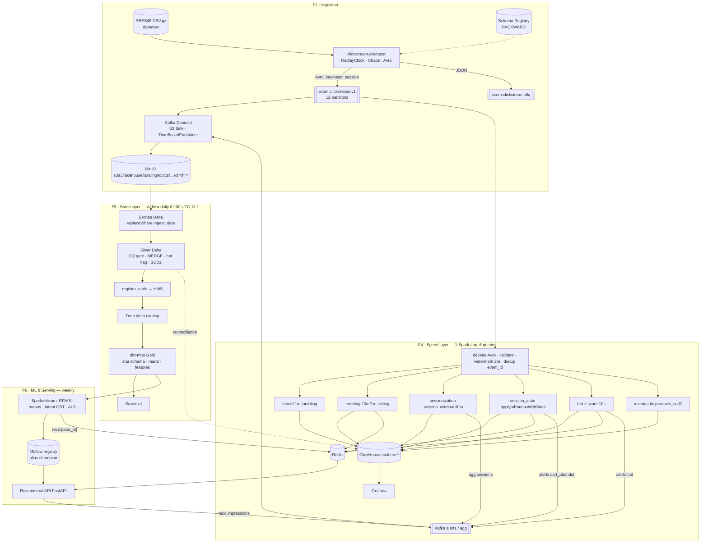

# IMPLEMENTATION GUIDE — E-commerce Big Data Platform (scope REES46)

> Tài liệu triển khai chi tiết cho nhóm. Đọc theo thứ tự §1 → §5 để dựng môi trường, sau đó mỗi cặp đi sâu vào flow của mình (§6 F1, §7 F4, §8 F5, §9 F6).
> Thuật ngữ kỹ thuật giữ nguyên tiếng Anh. Mọi đường dẫn file đều tương đối với gốc repo.
>
> Phiên bản tài liệu: 1.0 — 2026-10-26 · Trạng thái: scaffold đã chạy được `docker compose config`, unit test, local Spark test cho các streaming builder; chưa chạy full stack trên dữ liệu thật.

## Mục lục

1. [Bối cảnh & thay đổi scope](#1-bối-cảnh--thay-đổi-scope)
2. [Kiến trúc tổng thể](#2-kiến-trúc-tổng-thể)
3. [Cấu trúc thư mục](#3-cấu-trúc-thư-mục)
4. [Môi trường, phiên bản & tài nguyên](#4-môi-trường-phiên-bản--tài-nguyên)
5. [Dựng hệ thống từng bước (Quick start chi tiết)](#5-dựng-hệ-thống-từng-bước)
6. [F1 — Ingestion: REES46 → Kafka → Landing](#6-f1--ingestion)
7. [F4 — Speed layer (Spark Structured Streaming)](#7-f4--speed-layer)
8. [F5 — Batch layer (Medallion + dbt)](#8-f5--batch-layer)
9. [F6 — ML & Serving](#9-f6--ml--serving)
10. [Data contracts (tổng hợp)](#10-data-contracts)
11. [Data quality & Reconciliation](#11-data-quality--reconciliation)
12. [Orchestration (Airflow 3)](#12-orchestration-airflow-3)
13. [Observability](#13-observability)
14. [Testing strategy](#14-testing-strategy)
15. [Quy ước code, Git & CI](#15-quy-ước-code-git--ci)
16. [Roadmap & phân công nhóm](#16-roadmap--phân-công-nhóm)
17. [Runbook & troubleshooting](#17-runbook--troubleshooting)
18. [Rủi ro đã biết & hướng mở rộng](#18-rủi-ro-đã-biết--hướng-mở-rộng)
19. [Phụ lục: cheat sheet lệnh](#19-phụ-lục-cheat-sheet)

---

## 1. Bối cảnh & thay đổi scope

### 1.1 Bài toán

Sàn TMĐT cần trả lời đồng thời hai loại câu hỏi:

- **Ngay lúc này** khách đang làm gì (funnel, trending, giỏ bỏ dở, bot) — độ trễ giây/phút.
- **Về lâu dài** khách là ai, nên gợi ý gì (RFM, intent, recommendation) — cần lịch sử dài, xử lý batch.

Kiến trúc **Lambda**: speed layer cho độ trễ thấp + batch layer làm *source of truth*, có **reconciliation** để đo sai lệch giữa hai layer.

### 1.2 Scope mới (chỉ REES46)

| Hạng mục thiết kế gốc | Scope hiện tại | Ghi chú |
|---|---|---|
| F1 Clickstream REES46 → Kafka | ✅ Giữ | Nguồn duy nhất |
| F2 CDC Postgres (Olist) qua Debezium | ❌ Bỏ hẳn | Doanh thu lấy từ event `purchase` |
| F3 API ngoài (Open-Meteo, Frankfurter, Google Trends) + Kaggle Olist/Amazon | ❌ Bỏ | Không còn phân tích thời tiết/tỷ giá/vùng miền |
| F4 Speed layer | ✅ Giữ, thêm `revenue` stream (thay `rt_orders` từ CDC) | |
| F5 Batch medallion | ✅ Giữ, Delta Lake | |
| F6 ML: RFM, intent, ALS + Recommend API | ✅ Giữ (phase sau) | Bỏ sentiment |
| Reconciliation 3 chiều | → 2 chiều: Silver ↔ ClickHouse | |

Chi tiết lý do: [ADR-0001](adr/0001-scope-rees46-only.md).

### 1.3 Câu hỏi phân tích sau khi điều chỉnh

| # | Câu hỏi | Độ trễ | Layer | Nơi trả lời |
|---|---|---|---|---|
| Q1 | Conversion view → cart → purchase trong 5 phút gần nhất? | giây | Speed | `realtime.v_funnel_last_5m` (ClickHouse) → Grafana |
| Q2 | Top 10 sản phẩm/danh mục đang trending? | giây | Speed | Redis `trending:{cat}` + `realtime.rt_trending_10m` |
| Q3 | Phiên nào đang bỏ giỏ (cart > 0, không purchase sau 30')? | phút | Speed | topic `alerts.cart_abandon`, `realtime.rt_cart_abandon` |
| Q4 | User nào có hành vi giống bot? | giây | Speed (+ batch offline rule) | `alerts.bot`, Redis `bots:active`, `silver.bot_users` |
| Q5 | Doanh thu, AOV theo ngày/danh mục/brand | giờ/ngày | Batch (+ preview real-time `v_revenue_1m`) | `gold.mart_daily_sales` → Superset |
| Q6 | Phân khúc RFM, ai có nguy cơ rời bỏ? | ngày | Batch + ML | `ml.user_segments` → `gold.dim_user`, `gold.mart_customer_segments` |
| Q7 | Gợi ý gì cho khách này ngay lúc này? | < 100 ms | Serving (batch ALS + online context) | `GET /recommend/{user_id}` |
| Q8* | Thay đổi giá ảnh hưởng conversion thế nào? | ngày | Batch (SCD2) | `gold.mart_price_changes` |

\*Q8 gốc (review/giao hàng) không còn dữ liệu; thay bằng phân tích giá nhờ SCD2 sản phẩm.

### 1.4 Dataset REES46 — những điều phải biết trước khi code

Schema CSV (mỗi tháng 1 file, Oct ≈ 42M dòng / 5.3 GB, Nov ≈ 67M dòng / 8.4 GB):

| Cột | Kiểu | Đặc điểm cần xử lý |
|---|---|---|
| `event_time` | `"2019-10-01 00:00:00 UTC"` | Có hậu tố ` UTC` → parse thủ công (`reader.parse_event_time`) |
| `event_type` | view / cart / remove_from_cart / purchase | `remove_from_cart` chỉ có ở một số tháng |
| `product_id`, `category_id` | int / bigint | `category_id` vượt int32 → `long` |
| `category_code` | `electronics.smartphone` | **Null ~30%** → `category_l1/l2/l3 = 'unknown'` |
| `brand` | text | Null ~14%, viết hoa/thường lẫn lộn → `normalize_brand` (lower+trim) |
| `price` | double | Có giá 0; giá **thay đổi theo thời gian** cho cùng product → SCD2 |
| `user_id` | int | Ổn định giữa các session |
| `user_session` | UUID | Có thể null (rất ít) → DLQ; dùng làm session key có sẵn |

Không có `order_id`, `quantity` → định nghĩa *order* ở [ADR-0003](adr/0003-order-definition.md).

---

## 2. Kiến trúc tổng thể

### 2.1 Sơ đồ luồng dữ liệu



### 2.2 Nguyên tắc thiết kế (áp dụng xuyên suốt)

1. **Một nguồn sự thật cho định nghĩa**: path bảng (`libs/ecom_common/tables.py`), event weights/funnel (`transforms.py`), feature ML (`features.py`), DQ rules (`pipelines/quality/checks.py`). Streaming và batch import cùng code ⇒ reconciliation có ý nghĩa, không training-serving skew.
2. **Idempotent ở mọi sink**: Delta `replaceWhere`/`MERGE`; ClickHouse `ReplacingMergeTree` với ORDER BY = khóa tự nhiên; Redis `SET/HSET` ghi đè; Kafka producer `enable.idempotence=true`. Chạy lại một ngày / replay một micro-batch không tạo trùng.
3. **Bronze bất biến, có thể tính lại**: landing giữ file gốc; Bronze chỉ thêm lineage (`_source`, `_kafka_*`, `_landing_file`, `_ingest_ts`). Mọi lỗi logic sửa ở Silver rồi chạy lại.
4. **Partition theo thời gian ingest ở Bronze, theo event time ở Silver**: event đến trễ không bao giờ "rơi" vào partition đã đóng; Silver MERGE event trễ vào đúng `event_date` của nó và đánh dấu `arrived_late`.
5. **Mỗi bảng một writer**: Spark sở hữu bronze/silver/ml; dbt (Trino) sở hữu gold. Không bao giờ để 2 engine cùng ghi một bảng.
6. **12-factor config**: mọi thứ qua biến môi trường (`.env`), không hard-code host/credential trong code.
7. **Fail loud ở ranh giới**: DQ gate Bronze→Silver (>5% invalid ⇒ task fail, Gold không rebuild), dbt test fail ⇒ DAG fail, reconciliation lệch quá ngưỡng ⇒ fail.

### 2.3 Hai timeline: replay vs bulk

| | Replay (stream) | Bulk backfill |
|---|---|---|
| Đường đi | CSV → producer → Kafka → (speed + landing → Bronze) | CSV → `bulk_backfill.py` → Bronze trực tiếp |
| `event_time` | dời về "bây giờ" (`REPLAY_TIME_MODE=shift`), giữ khoảng cách gốc chia `REPLAY_SPEED`; `original_event_time` giữ giá trị gốc | giữ nguyên 2019-10 … 2020-04 |
| `_source` | `kafka_connect` | `bulk_csv` |
| Mục đích | demo real-time, reconciliation | lịch sử dài cho ML/BI |

Hai timeline không chồng nhau về ngày ⇒ không xung đột partition; reconciliation chỉ dùng `_source='kafka_connect'`.

### 2.4 Mapping thành phần → container (docker compose profiles)

| Profile | Service | Vai trò |
|---|---|---|
| *(core, luôn chạy)* | `postgres`, `minio` (+`minio-init`), `kafka` (+`kafka-init`), `schema-registry`, `redis`, `clickhouse` | Hạ tầng lưu trữ & messaging |
| `stream` | `kafka-connect` (+`connect-init`), `spark-master`, `spark-worker`, `spark-streaming` | Landing + speed layer |
| `replay` | `clickstream-producer` | Phát lại REES46 |
| `batch` | `hive-metastore`, `trino`, `airflow-init/apiserver/scheduler/dag-processor/triggerer` | Cold path |
| `bi` | `grafana`, `superset`, `jupyter` (+ trino, hms) | Tiêu thụ |
| `ml` | `mlflow`, `recommend-api` | ML & serving |
| `obs` | `prometheus`, `kafka-exporter`, `kafka-ui` | Giám sát |

---

## 3. Cấu trúc thư mục

```
ecom-bigdata-platform/
├── .github/workflows/ci.yml        # lint + unit test + compose config + dbt parse + build images
├── data/                           # (gitignored) raw/ = REES46 gốc, sample/ = mẫu 1% cho dev/CI
├── docs/
│   ├── IMPLEMENTATION_GUIDE.md     # tài liệu này
│   └── adr/                        # Architecture Decision Records (0001…0004)
├── infra/                          # MỌI thứ về hạ tầng: Dockerfile + config, không chứa business logic
│   ├── airflow/                    # image Airflow 3 + Java + pyspark + dbt venv
│   ├── clickhouse/init/            # DDL realtime.* (chạy tự động lần đầu)
│   ├── grafana/                    # provisioning datasource + dashboard JSON (as code)
│   ├── hive-metastore/             # HMS 4.0.0 + hadoop-aws + JDBC postgres
│   ├── kafka/create_topics.sh      # topic as code (partitions, retention)
│   ├── kafka-connect/              # image + đăng ký S3 sink (PUT idempotent)
│   ├── minio/  postgres/           # tạo bucket / database
│   ├── mlflow/  prometheus/  superset/
│   ├── spark/                      # image Spark 3.5.5 (Python 3.11) + jars + spark-defaults
│   └── trino/etc/                  # config + catalog delta (HMS) & clickhouse
├── schemas/                        # DATA CONTRACTS
│   ├── avro/clickstream_event.avsc # schema Kafka (Schema Registry, BACKWARD)
│   └── json/alerts.schema.json     # schema các topic alert/agg (JSON)
├── libs/ecom_common/               # thư viện dùng chung (mount vào mọi container Spark/Airflow)
│   ├── config.py                   # Settings typed từ env
│   ├── spark.py                    # get_spark(): S3A, Delta, driver host
│   ├── tables.py                   # registry path/fqn của mọi bảng Delta
│   ├── transforms.py               # category levels, brand, event weights, funnel aggs
│   ├── features.py                 # INTENT_FEATURES dùng chung train/serve
│   ├── avro.py  log.py
├── services/                       # ứng dụng chạy dài hạn, mỗi cái 1 image riêng
│   ├── clickstream-producer/       # replay REES46 → Kafka (Avro), chaos, metrics
│   └── recommend-api/              # FastAPI: candidates (Redis) + context + intent → top-k
├── pipelines/                      # BUSINESS LOGIC
│   ├── streaming/                  # common.py (read/decode/clean), jobs/*, sinks/*, run.py
│   ├── batch/                      # bronze_load, silver_*, bulk_backfill, reconciliation, maintenance, register_tables
│   ├── quality/checks.py           # framework DQ (row checks + gate + quarantine)
│   ├── dbt/                        # Gold: staging → marts/core (star) → marts/analytics → features
│   └── ml/                         # segmentation, purchase_intent, als_recommender, batch_scoring
├── orchestration/airflow/
│   ├── dags/                       # medallion_daily, ml_weekly, maintenance_weekly, bulk_backfill
│   ├── ecom_airflow/               # factory task (spark_task, dbt_task), Assets
│   └── tests/                      # DAG integrity test
├── scripts/                        # download_rees46.sh, make_sample.py, smoke_test.sh
├── tests/                          # unit test pipelines (+ load/locustfile.py)
├── notebooks/                      # EDA / prototype (không phải code production)
├── docker-compose.yml  .env.example  Makefile  pyproject.toml  requirements-dev.txt
└── .pre-commit-config.yaml  .editorconfig  .gitignore  .dockerignore  README.md
```

**Quy ước tách lớp** (giống các repo data platform hiện đại):

- `infra/` = *how it runs*, `pipelines/` = *what it computes*, `orchestration/` = *when it runs*, `schemas/` = *what it promises*. Một PR đổi logic không cần đụng `infra/`, và ngược lại.
- Code dùng chung đặt ở `libs/` (được mount `ro`, có trong `PYTHONPATH` của driver *và* executor qua `spark.executorEnv.PYTHONPATH`).
- Mỗi job batch là một file chạy được độc lập: `spark-submit pipelines/batch/<job>.py --ds YYYY-MM-DD`. Airflow chỉ gọi lại đúng lệnh đó ⇒ debug thủ công = chạy lại đúng câu lệnh trong log Airflow.
- Mỗi streaming job có `build(df) -> DataFrame` (logic thuần, test được) và `start(spark, settings) -> StreamingQuery` (I/O). Unit test chỉ test `build`/hàm thuần.

---

## 4. Môi trường, phiên bản & tài nguyên

### 4.1 Ma trận phiên bản (pin trong `.env.example`)

| Thành phần | Phiên bản | Lý do chọn / ràng buộc |
|---|---|---|
| Python | 3.11 | Cùng version ở Spark image, Airflow image, producer, API ⇒ không lỗi pickle/UDF giữa driver và executor |
| Spark | 3.5.5 (Scala 2.12, PyPI pyspark) | Bản 3.5 LTS, Delta 3.3 hỗ trợ; image tự build từ `python:3.11-slim` + OpenJDK 17 |
| Delta Lake | 3.3.2 | Tương thích Spark 3.5; `dropDuplicatesWithinWatermark`, MERGE, replaceWhere |
| hadoop-aws / AWS SDK v1 | 3.3.4 / 1.12.262 | Khớp Hadoop client đi kèm Spark 3.5 |
| Kafka | apache/kafka 3.9.1 (KRaft, không Zookeeper) | Image chính thức, 1 broker cho dev |
| Confluent (Schema Registry, Connect) | 7.9.1 | Tương thích Kafka 3.9; S3 sink connector cài qua confluent-hub |
| MinIO | `quay.io/minio/minio:latest` (cấu hình được) | MinIO ngừng phát hành image community trên Docker Hub; có thể đổi sang `pgsty/minio`, `cgr.dev/chainguard/minio` |
| Hive Metastore | apache/hive 4.0.0 | Chỉ phục vụ Trino; 4.0.1+ bỏ một số Thrift API |
| Trino | 476 | Delta connector + `register_table`, native S3 |
| ClickHouse | 25.3 (LTS) | ReplacingMergeTree, TTL, `LIMIT n BY` |
| Redis | 7.4 | ZSET/HASH/SET, `COPY` (≥ 6.2) |
| Airflow | 3.3.0 | Task SDK, Assets, api-server tách riêng |
| dbt | dbt-trino 1.9.0, dbt-core ≥ 1.10 | Cú pháp test `arguments:` mới |
| MLflow | 2.22.0 | Model registry alias (`@champion`) |
| Grafana / Superset | 11.6.0 / 4.1.2 | ClickHouse plugin / Trino driver |

> **Quy tắc nâng version**: đổi trong `.env.example` → `make build` → chạy `make smoke` + `make test` → ghi chú trong PR. Không dùng tag `latest` cho thành phần có state (trừ MinIO đã ghi chú).

### 4.2 Tài nguyên khuyến nghị

| Kịch bản | Profile | RAM Docker | CPU |
|---|---|---|---|
| Chỉ hot path | core + stream + replay | ~8 GB | 4 |
| Hot + cold path | + batch | ~12 GB | 6 |
| Toàn bộ | tất cả | ≥ 16 GB | 8 |

Giảm tải khi máy yếu: `SPARK_WORKER_MEMORY=4g`, `STREAMING_JOBS=funnel,trending,session_state`, `CLICKSTREAM_PARTITIONS=6`, dùng `data/sample`.

### 4.3 Cổng & endpoint nội bộ

| Service | Host port | Trong mạng docker |
|---|---|---|
| Kafka | 29092 (EXTERNAL) | `kafka:9092` |
| Schema Registry | 8081 | `http://schema-registry:8081` |
| Kafka Connect REST | 8083 | `http://kafka-connect:8083` |
| MinIO API / console | 9000 / 9001 | `http://minio:9000` |
| Postgres | 5432 | `postgres:5432` (DB: metastore, airflow, mlflow, superset) |
| Redis | 6379 | `redis:6379` (có password) |
| ClickHouse HTTP / native | 8123 / 9002 | `clickhouse:8123` / `:9000` |
| Spark master UI / app UI | 8080 / 4040 | `spark://spark-master:7077` |
| Trino | 8090 | `http://trino:8080` |
| Airflow | 8091 | `http://airflow-apiserver:8080` |
| Grafana / Superset / Jupyter | 3000 / 8088 / 8888 | |
| MLflow / Recommend API | 5000 / 8000 | `http://mlflow:5000` / `http://recommend-api:8000` |
| Prometheus / producer metrics | 9090 / 8001 | |

### 4.4 Biến môi trường quan trọng

| Biến | Mặc định | Ý nghĩa |
|---|---|---|
| `REPLAY_SPEED` | 10 | Tốc độ phát lại (10 = 1 giờ dữ liệu trong 6 phút). `0` = nhanh nhất có thể |
| `REPLAY_TIME_MODE` | shift | `shift` dời event_time về hiện tại; `original` giữ 2019 (chỉ để test batch) |
| `REPLAY_MAX_EVENTS` | 0 | Giới hạn số event (0 = không giới hạn) |
| `CHAOS_ENABLED` + `CHAOS_*` | false | Bơm event trễ (`LATE_RATIO`, `LATE_DELAY_SECONDS`), trùng (`DUP_RATIO`), bot burst (`BOT_BURST_PROB`) để kiểm thử watermark/dedup/bot |
| `STREAMING_JOBS` | all | Danh sách query chạy trong app streaming |
| `STREAMING_WATERMARK` | "2 minutes" | Độ trễ cho phép (đổi ⇒ phải xóa checkpoint, xem §17) |
| `STREAMING_TRIGGER_SECONDS` | 10 | Chu kỳ micro-batch |
| `STREAMING_MAX_OFFSETS_PER_TRIGGER` | 200000 | Backpressure khi catch-up |
| `CART_ABANDON_TIMEOUT_MINUTES` | 30 | Q3 |
| `BOT_ZSCORE_THRESHOLD` / `BOT_MIN_EVENTS_10S` | 3.0 / 20 | Q4 |
| `LAKEHOUSE_ROOT` / `CHECKPOINT_ROOT` | (rỗng) | Override `s3a://lakehouse` (vd. `file:///tmp/lh` để test local) |
| `INTENT_MODEL_URI` | models:/purchase_intent@champion | Model API nạp lúc khởi động |
| `ML_SOURCE` | auto | Timeline mà feature/ML neo vào: `auto` (bulk nếu đã backfill, ngược lại replay), `bulk_csv`, `kafka_connect`, `all` (xem §9) |

**Bảo mật**: `.env` đã nằm trong `.gitignore`; các secret trong `.env.example` chỉ là giá trị dev. Môi trường thật: dùng secret manager (Vault/SOPS/Docker secrets), đổi toàn bộ password, bật TLS cho MinIO/Kafka. `pre-commit` có `gitleaks` và `detect-private-key`.

---

## 5. Dựng hệ thống từng bước

> Mỗi bước có **kiểm tra (✔)** — không sang bước sau khi bước trước chưa xanh.

### Bước 0 — Chuẩn bị

```bash
git clone <repo> && cd ecom-bigdata-platform
make init            # tạo .env (sinh AIRFLOW_FERNET_KEY), build image: spark, airflow, connect, hms, producer, api, superset, mlflow
```

✔ `docker images | grep ecom/` thấy `ecom/spark`, `ecom/airflow`, `ecom/clickstream-producer`, `ecom/recommend-api`, …

### Bước 1 — Dữ liệu

```bash
# điền KAGGLE_USERNAME / KAGGLE_KEY trong .env
make download        # data/raw/2019-Oct.csv.gz, 2019-Nov.csv.gz
make sample          # data/sample/rees46_sample.csv.gz (1% session, 3 ngày ≈ 100–150k dòng)
```

Dev hằng ngày dùng sample: đặt `REES46_INPUT=/data/sample/rees46_sample.csv.gz` trong `.env`.

✔ `zcat data/sample/rees46_sample.csv.gz | head -3` có header `event_time,event_type,product_id,...`

### Bước 2 — Core

```bash
make up-core
docker compose ps    # tất cả healthy; minio-init, kafka-init: exited (0)
```

✔ `make smoke` phần `== core` toàn `[OK]`: bucket `lakehouse`, `checkpoints`, `mlflow` có trong MinIO console; 6 topic tạo xong; `realtime.*` có trong ClickHouse.

### Bước 3 — Hot path

```bash
make up-stream       # kafka-connect + connect-init (đăng ký 2 S3 sink) + spark cluster + spark-streaming
make replay          # clickstream-producer
make logs s=spark-streaming
```

✔ Kiểm tra theo thứ tự đường đi dữ liệu:

1. Producer: `curl -s localhost:8001/metrics | grep producer_events_sent_total` tăng dần.
2. Schema Registry: `curl -s localhost:8081/subjects` có `ecom.clickstream.v1-value`.
3. Spark UI http://localhost:4040 → tab *Structured Streaming*: 6–7 query active, *Input rows/s* > 0.
4. ClickHouse: `SELECT * FROM realtime.v_funnel_last_5m` có dữ liệu.
5. Redis: `docker compose exec redis redis-cli -a $REDIS_PASSWORD --scan --pattern 'trending:*' | head`.
6. Landing: sau ~1–2 phút (`rotate.schedule.interval.ms=60000` hoặc đủ `flush.size`) có file Parquet trong `lakehouse/landing/topics/ecom.clickstream.v1/dt=…/hr=…/`.
7. Grafana http://localhost:3000 → dashboard *E-commerce · Real-time (speed layer)*.

### Bước 4 — Cold path

```bash
make up-batch        # hive-metastore, trino, airflow
# Airflow UI http://localhost:8091 → bật DAG medallion_daily
# hoặc chạy tay cho hôm nay (dữ liệu replay mang ngày hiện tại):
make medallion DS=$(date -u +%F)
```

✔ Trino: `docker compose exec trino trino --execute "SELECT count(*) FROM delta.silver.events"`; `SHOW TABLES FROM delta.gold` có `fact_events`, `mart_daily_sales`, …; bảng `gold.mart_reconciliation` có dòng với `status='ok'`.

### Bước 5 — Lịch sử dài cho ML/BI (tùy chọn nhưng nên làm)

```bash
make backfill INPUT=/data/raw/2019-Oct.csv.gz       # → bronze (_source=bulk_csv)
# xử lý Silver/Gold cho các ngày lịch sử: Airflow backfill (chạy tuần tự vì SCD2 depends_on_past)
docker compose exec airflow-scheduler airflow backfill create --dag-id medallion_daily \
  --from-date 2019-10-02 --to-date 2019-11-01 --max-active-runs 1
```

> DAG xử lý D-1, nên run ngày 2019-10-02 xử lý dữ liệu 2019-10-01. `bronze_load` không thấy landing của ngày 2019 sẽ bỏ qua (không ghi đè dữ liệu bulk vì `replaceWhere` có điều kiện `_source='kafka_connect'`).

### Bước 6 — ML & Serving

```bash
make up-ml
make ml              # segmentation → purchase_intent → als → batch_scoring
docker compose restart recommend-api   # nạp champion mới
curl "localhost:8000/recommend/512475445?k=5"
```

✔ MLflow http://localhost:5000 có 3 experiment, model `purchase_intent` có alias `champion`; API trả `strategy: "als+session"` cho user có trong `ml.user_recs`, `cold_start_trending` cho user lạ.

### Bước 7 — BI

```bash
make up-bi           # grafana, superset (bootstrap tạo DB connection Trino), jupyter
```

Superset → *SQL Lab* → database `Lakehouse (Trino)` → `SELECT * FROM delta.gold.mart_daily_sales ORDER BY order_date DESC`.

---

## 6. F1 — Ingestion

**Mục tiêu**: biến file CSV tĩnh thành một *luồng sự kiện* thực tế (có thứ tự thời gian, tốc độ điều khiển được, có lỗi/trễ/trùng/bot) và lưu bản gốc bất biến vào landing zone.

**Code**: `services/clickstream-producer/`, `schemas/avro/`, `infra/kafka/`, `infra/kafka-connect/`.

### 6.1 Replay producer — luồng xử lý

```
reader.iter_rows()          # pyarrow đọc CSV.gz theo block 32MB, parse "… UTC", sort trong block
   │
transform.to_record()       # validate → InvalidEvent(reason) ⇒ DLQ ; sinh event_id = sha256(natural key)
   │                         # ReplayClock: event_time mới, original_event_time = gốc
chaos.ChaosInjector         # (tùy chọn) giữ lại event để phát trễ, nhân bản, sinh bot burst
   │
rate_limiter.ReplayPacer    # ngủ tới scheduled_wall_time ⇒ giữ đúng nhịp gốc / REPLAY_SPEED
   │
publisher.ClickstreamPublisher
   ├─ AvroSerializer (Schema Registry, auto-register)  → ecom.clickstream.v1  key=user_session
   └─ JSON + reason                                    → ecom.clickstream.dlq
```

**Các quyết định quan trọng và lý do**:

| Quyết định | Lý do |
|---|---|
| **Key = `user_session`** | Mọi event của một session vào cùng partition ⇒ giữ thứ tự trong session (quan trọng cho state Q3), phân phối đều (session nhiều hơn user, tránh hot key của user/bot) |
| `event_id` = sha256(user_session, event_time, product_id, event_type) sinh tại producer (đúng natural key của Silver) | REES46 không có ID; cần khóa để dedup ở stream (`dropDuplicatesWithinWatermark`). Khóa tất định ⇒ dòng trùng trong file nguồn có cùng `event_id`, nên stream và Silver (dedup theo natural key) loại **cùng** một tập bản trùng. Chaos *duplicate* gửi lại **cùng** `event_id` ⇒ test được dedup |
| `REPLAY_TIME_MODE=shift` | Dashboard "5 phút gần nhất" chỉ có nghĩa nếu event_time ≈ now. Giữ `original_event_time` để truy vết |
| `enable.idempotence=true`, `acks=all`, `compression=lz4`, `linger.ms` | Exactly-once phía producer (không trùng khi retry), throughput tốt |
| Validate trước khi gửi ⇒ DLQ | Dữ liệu bẩn không làm vỡ consumer; DLQ được Kafka Connect đưa xuống landing để phân tích |
| Prometheus metrics (`:8001`) | `producer_events_sent_total{event_type}`, `producer_events_dlq_total{reason}`, `producer_delivery_errors_total`, `producer_chaos_injected_total{kind}`, `producer_replay_lag_seconds` |

**Chaos testing** (`CHAOS_ENABLED=true`):

- `late`: giữ event `CHAOS_LATE_DELAY_SECONDS` (240s > watermark 120s) rồi mới gửi ⇒ kiểm chứng event bị speed layer bỏ qua nhưng batch vẫn có (`arrived_late=true`), reconciliation phản ánh đúng phần chênh.
- `dup`: gửi lại bản sao ⇒ speed layer phải dedup, Silver MERGE không nhân đôi.
- `bot`: burst hàng trăm event/giây từ `user_id ≥ 2_000_000_000` ⇒ ground truth cho precision/recall của Q4 (`chaos_tag='bot'`).

**Việc cần làm (checklist F1)**:

- [ ] Chạy `pytest services/clickstream-producer/tests` (đã có test transform/clock/DLQ).
- [ ] Đo throughput tối đa: `REPLAY_SPEED=0 REPLAY_MAX_EVENTS=1000000`, ghi lại events/s và CPU (mục tiêu ≥ 20k ev/s trên laptop).
- [ ] Bổ sung test thống kê cho `ChaosInjector` (tỷ lệ late/dup thực tế ≈ cấu hình ±10% trên 100k record); test hành vi cơ bản đã có.
- [ ] Theo dõi `producer_replay_lag_seconds`: nếu tăng liên tục ⇒ producer không theo kịp tốc độ ⇒ giảm `REPLAY_SPEED` hoặc tăng partition.

### 6.2 Kafka topics (topic as code — `infra/kafka/create_topics.sh`)

| Topic | Partitions | Retention | Format | Producer → Consumer |
|---|---|---|---|---|
| `ecom.clickstream.v1` | 12 (`CLICKSTREAM_PARTITIONS`) | 7 ngày, lz4 | Avro (SR) | producer → Spark streaming, Connect |
| `ecom.clickstream.dlq` | 3 | 14 ngày | JSON | producer, Spark DLQ query → Connect |
| `agg.sessions` | 6 | 7 ngày | JSON | sessionization → Connect |
| `alerts.cart_abandon` | 3 | 7 ngày | JSON | session_state → Connect, (CRM/marketing) |
| `alerts.bot` | 3 | 7 ngày | JSON | bot_detection → Connect |
| `reco.impressions` | 3 | 7 ngày | JSON | Recommend API → Connect |

- Hậu tố `.v1` trong tên topic: thay đổi **không tương thích** ⇒ topic mới `.v2` + chạy song song, không sửa tại chỗ.
- Số partition = mức song song tối đa của consumer. Spark đọc 12 partition ⇒ tối đa 12 task/micro-batch. Muốn scale: tăng partition (chỉ tăng, không giảm) + thêm worker.
- Dev 1 broker ⇒ `replication.factor=1`. Production: RF=3, `min.insync.replicas=2`.

### 6.3 Schema Registry & schema evolution

`schemas/avro/clickstream_event.avsc` là **data contract**. Compatibility `BACKWARD` (consumer schema mới đọc được dữ liệu cũ):

- ✅ Được phép: thêm field **có default** (vd. `"device": ["null","string"], "default": null`), xóa field có default.
- ❌ Không được: đổi kiểu, đổi tên, thêm field bắt buộc ⇒ tạo topic `.v2`.
- Quy trình đổi schema: sửa `.avsc` → PR → CI kiểm tra compatibility (`curl -X POST $SR/compatibility/subjects/ecom.clickstream.v1-value/versions/latest -d @schema.json`) → deploy producer.

Spark đọc Avro theo Confluent wire format: byte 0 = magic, byte 1–4 = schema id, phần còn lại là Avro binary ⇒ `ecom_common.avro.decode_confluent_avro` cắt 5 byte đầu rồi `from_avro(..., {"mode": "PERMISSIVE"})`. Record lỗi ⇒ `NULL` ⇒ `is_valid=false` ⇒ DLQ query (không làm chết stream).

### 6.4 Kafka Connect → landing zone (MinIO)

`infra/kafka-connect/register_connectors.sh` đăng ký (PUT = create-or-update, chạy lại an toàn):

| Connector | Topics | Format ghi | flush.size |
|---|---|---|---|
| `s3-sink-clickstream` | `ecom.clickstream.v1` | Parquet (từ Avro) | 50 000 |
| `s3-sink-hotpath-outputs` | alerts.*, agg.sessions, reco.impressions, dlq | JSON | 5 000 |

Cấu hình chung đáng chú ý:

- `TimeBasedPartitioner`, `path.format='dt'=YYYY-MM-dd/'hr'=HH`, `timestamp.extractor=Record` ⇒ partition theo **thời điểm ghi vào Kafka** (ingest time), không phải event time. Event đến trễ vẫn nằm ở partition "mới" ⇒ batch daily luôn nhặt được.
- `rotate.schedule.interval.ms=60000` ⇒ file được commit ít nhất mỗi phút (dữ liệu landing "tươi"). Đánh đổi: scheduled rotation **mất đảm bảo exactly-once** của S3 sink khi connector restart ⇒ có thể có bản ghi trùng giữa các file. Chấp nhận được vì Silver dedup theo natural key (§8.2).
- SMT `InsertField` thêm `_kafka_offset`, `_kafka_partition`, `_kafka_ts` vào value ⇒ lineage tới tận offset.
- `errors.tolerance=all` + log ⇒ một record lỗi không làm dừng connector (record lỗi đã bị chặn từ producer/DLQ).

Kết quả trên MinIO:

```
s3://lakehouse/landing/topics/ecom.clickstream.v1/dt=2026-10-26/hr=14/ecom.clickstream.v1+3+0000120000.snappy.parquet
s3://lakehouse/landing/topics/alerts.bot/dt=2026-10-26/hr=14/alerts.bot+0+0000000000.json
```

✔ Kiểm tra: `curl -s localhost:8083/connectors/s3-sink-clickstream/status | jq '.tasks[].state'` = `"RUNNING"`; consumer lag của group `connect-s3-sink-clickstream` ổn định (Kafka UI).

---

## 7. F4 — Speed layer

**Mục tiêu**: trả lời Q1–Q4 (+ preview Q5) với độ trễ end-to-end vài giây, chịu được dữ liệu trễ/trùng, khởi động lại không mất/không nhân đôi kết quả.

**Code**: `pipelines/streaming/` — chạy bằng service `spark-streaming`:

```bash
spark-submit /opt/app/pipelines/streaming/run.py --jobs all          # dev: 1 app, nhiều query
spark-submit /opt/app/pipelines/streaming/run.py --jobs funnel       # prod: 1 app / job
```

### 7.1 Input chung: `clean_events()`

```
Kafka (startingOffsets=latest, maxOffsetsPerTrigger=200k, failOnDataLoss=false)
  → decode Confluent Avro (PERMISSIVE)                → is_valid
  → where is_valid                                     (invalid → start_dlq_query → topic DLQ)
  → normalize_brand(), category_l1/l2/l3
  → withWatermark("event_time", "2 minutes")
  → dropDuplicatesWithinWatermark(["event_id"])
```

- **Watermark 2 phút**: event có `event_time` < max(event_time) − 2' bị coi là quá trễ, bị bỏ khỏi aggregate. Giá trị chọn từ phân phối độ trễ đo được (chaos late 240s ⇒ chủ đích bị loại để kiểm chứng). Tăng watermark = chính xác hơn nhưng state lớn hơn và kết quả "chốt" muộn hơn.
- **Dedup within watermark**: state của `event_id` chỉ giữ trong khoảng watermark ⇒ không phình vô hạn như `dropDuplicates` thường.
- Mỗi query gọi `clean_events()` riêng ⇒ mỗi query có Kafka source + checkpoint riêng ⇒ restart/scale độc lập; đổi lại tốn CPU decode nhiều lần. Khi cần tối ưu: tách 1 job "clean" ghi ra topic `ecom.clickstream.clean` rồi các job khác đọc từ đó.

### 7.2 Các streaming job

| Query (`queryName`; tên trong `--jobs`: funnel, trending, sessionization, session_state, bot, revenue) | Câu hỏi | Kỹ thuật | Output mode | Sink |
|---|---|---|---|---|
| `funnel_1m` | Q1 | tumbling window 1' × `category_l1`, `funnel_aggs()` | update | ClickHouse `rt_funnel_1m` |
| `trending_10m` | Q2 | sliding window 10' / slide 1' × category × product, score = Σ weight (view 1, cart 3, purchase 5) | update | ClickHouse `rt_trending_10m`, Redis `trending:{cat}` |
| `sessions_closed` | Q3 (báo cáo) | `session_window(event_time, 30 min)` × user_session | append (chỉ emit khi session đóng) | ClickHouse `rt_sessions`, Kafka `agg.sessions` |
| `session_state` | Q3 (cảnh báo) + feature online Q7 | `applyInPandasWithState`, `EventTimeTimeout` 30' | update | Redis `session:{id}`, Kafka `alerts.cart_abandon`, ClickHouse `rt_cart_abandon` |
| `bot_detection` | Q4 | tumbling 10s × user_id → z-score theo cửa sổ | append (cửa sổ đã chốt) | ClickHouse `rt_bot_alerts`, Redis `bots:active`, Kafka `alerts.bot` |
| `revenue_enriched` | Q5 preview | stream–static join purchase ⋈ `silver.products_scd2` (current) | append | ClickHouse `rt_purchases` |
| `dlq` | – | record invalid | append | Kafka `ecom.clickstream.dlq` |

#### 7.2.1 Funnel (Q1)

`v_funnel_last_5m` (ClickHouse view) cộng các cửa sổ 1 phút trong 5 phút gần nhất và tính `cart_rate = carts/views`, `purchase_rate = purchases/views`. Vì sink là **update mode** (mỗi micro-batch gửi giá trị *đầy đủ mới nhất* của window đang mở), bảng dùng `ReplacingMergeTree(updated_at)` ORDER BY `(window_start, category_l1)` ⇒ đọc với `FINAL` (hoặc `argMax`) luôn ra giá trị cuối.

#### 7.2.2 Trending (Q2)

- Sliding window ⇒ mỗi event thuộc 10 window ⇒ state ×10; giữ ở mức chấp nhận được nhờ watermark.
- **Không xếp hạng trong Spark**: ranking trong một micro-batch update-mode là sai (batch chỉ chứa các row vừa thay đổi). Thay vào đó:
  - ClickHouse: dashboard dùng `ORDER BY score DESC LIMIT 10 BY category_l1` trên window mới nhất.
  - Redis: ghi ZSET theo window `trending:{cat}:w:{window_end}` (ZADD set = idempotent), rồi `COPY … REPLACE` window phủ đủ 10' gần nhất (`window_end` lớn nhất − 9', vì window có `window_end` lớn nhất mới mở, chỉ chứa ~1' dữ liệu) sang `trending:{cat}` (atomic swap cho reader), TTL 20'. `trending:categories` (ZSET cat → window_end) cho API biết category nào có dữ liệu.

#### 7.2.3 Session state & cart abandonment (Q3)

State mỗi `user_session`: `(user_id, n_views, n_carts, n_removes, n_purchases, cart_value, recent_categories, first_ts, last_ts)`.

- Mỗi micro-batch: cập nhật state, emit row `kind='update'` ⇒ Redis `session:{id}` (HASH, TTL 1h) — chính là **feature online** cho API (§9.5).
- Timeout = `last_event_time + 30'` theo **event time** (`setTimeoutTimestamp`, luôn > watermark hiện tại). Khi watermark vượt timeout ⇒ `hasTimedOut` ⇒ nếu `cart_items > 0 and n_purchases == 0` ⇒ emit `kind='abandon'` ⇒ Kafka `alerts.cart_abandon` + ClickHouse; state bị xóa.
- Vì dùng event time, khi replay nhanh (`REPLAY_SPEED=10`) 30 phút dữ liệu trôi qua trong 3 phút thực ⇒ alert xuất hiện sớm tương ứng — đúng ngữ nghĩa.
- `sessionization` (session_window) là bản "báo cáo" cho session đã đóng; `session_state` là bản "hành động" (alert + feature). Hai cách cho cùng câu hỏi để so sánh trong báo cáo.

Đã kiểm chứng local (Spark 3.5.5 + Java 17 + pyarrow 17/18): `session_state` chạy với nguồn file streaming, emit đúng `cart_items`, `last_category`.

#### 7.2.4 Bot detection (Q4)

- Đếm event/user trong cửa sổ 10s; trong mỗi micro-batch tính `z = (count − mean)/std` theo window; flag nếu `z > BOT_ZSCORE_THRESHOLD` **và** `count ≥ BOT_MIN_EVENTS_10S` (tránh flag khi phân phối hẹp).
- Hàm `score()` thuần pandas ⇒ unit test (`tests/unit/test_pure_functions.py`).
- **Append mode**: cửa sổ chỉ được emit một lần khi watermark vượt qua, với số đếm cuối cùng và toàn bộ user của cửa sổ trong cùng micro-batch ⇒ z-score tính trên quần thể đầy đủ, mỗi user bị cảnh báo một lần/cửa sổ. Đổi lại alert trễ ≈ watermark + 10s.
- Output: Redis `bots:active` (SET, TTL 1h) ⇒ API trả 429 cho bot; Kafka `alerts.bot` ⇒ landing ⇒ `bronze.alerts_bot` ⇒ Silver gắn `is_bot`.
- Đánh giá: precision/recall so với `chaos_tag='bot'` (ground truth). Batch bổ sung rule offline (> 60 event/phút) và có thể nâng lên Isolation Forest ở phase sau.

#### 7.2.5 Revenue enriched (Q5 preview)

Event `purchase` join với `silver.products_scd2` (bản current) để lấy `list_price`, brand chuẩn. Dimension đọc lại **bên trong foreachBatch** ⇒ SCD2 mới do batch đêm ghi sẽ được thấy mà không cần restart query. Nếu bảng chưa tồn tại (ngày đầu) ⇒ ghi với `list_price = NULL`.

### 7.3 Sinks & exactly-once

Spark đảm bảo **exactly-once nội bộ** (offset + state trong checkpoint). Ra ngoài là **at-least-once** (một micro-batch có thể được ghi lại sau crash) ⇒ biến thành *effectively-once* bằng sink idempotent:

| Sink | Cơ chế idempotent |
|---|---|
| ClickHouse | `ReplacingMergeTree(version)` + ORDER BY khóa nghiệp vụ; đọc bằng `FINAL`/view |
| Redis | `HSET`, `ZADD`, `SADD`, `SET` đều ghi đè; key theo window/session |
| Kafka (alerts) | consumer phía sau dedup theo (user_session, alerted_at) / (user_id, window_start) |
| Delta (batch) | `MERGE`/`replaceWhere` |

Checkpoint: `s3a://checkpoints/<queryName>` (1 thư mục / query). State store: **RocksDB** (`spark-defaults.conf`) ⇒ state lớn không làm OOM JVM heap.

### 7.4 ClickHouse schema (`infra/clickhouse/init/01_realtime_schema.sql`)

| Bảng | ORDER BY (khóa idempotent) | TTL |
|---|---|---|
| `rt_funnel_1m` | (window_start, category_l1) | 30 ngày |
| `rt_trending_10m` | (window_end, category_l1, product_id) | 7 ngày |
| `rt_sessions` | (toDate(session_start), user_session) | 30 ngày |
| `rt_cart_abandon` | (toDate(last_event_time), user_session) | 30 ngày |
| `rt_bot_alerts` | (window_start, user_id) | 30 ngày |
| `rt_purchases` | (toDate(event_time), event_id) | 30 ngày |

View: `v_funnel_last_5m` (Q1), `v_revenue_1m` (Q5 preview), `v_consistency_1m` (so funnel purchases vs rt_purchases — kiểm tra nhất quán nội bộ speed layer).

### 7.5 Grafana (dashboard as code)

`infra/grafana/dashboards/realtime_overview.json` (provisioned tự động, datasource ClickHouse): funnel 5', conversion theo phút, doanh thu theo phút (rt_purchases), top-10 trending (`LIMIT 10 BY`), cart-abandon alert/phút, bot alerts mới nhất, consistency (funnel purchases − enriched purchases), Kafka input rate và consumer lag (Prometheus). Nên bổ sung panel *freshness* = `now() − max(window_end)` khi đo latency. Sửa dashboard trên UI → *Export JSON* → ghi đè file → commit.

### 7.6 Tuning & vận hành speed layer

| Triệu chứng | Nguyên nhân thường gặp | Xử lý |
|---|---|---|
| Batch duration > trigger interval | Quá nhiều query/1 app, ít core | Tách app theo job, tăng `SPARK_WORKER_CORES`, giảm `maxOffsetsPerTrigger` |
| State tăng liên tục | Watermark không tiến (một partition không có dữ liệu) / event_time sai | Kiểm tra *Watermark* trong Spark UI; đảm bảo producer phát đều mọi partition |
| Đổi watermark/aggregate không có hiệu lực / lỗi khi start | Checkpoint không tương thích với query mới | Xóa `s3a://checkpoints/<query>` (mất state; chấp nhận vì sink idempotent) |
| Kafka lag tăng | Consumer chậm | Tăng partition + executor; xem `kafka_consumergroup_lag` (Prometheus) |
| ClickHouse "Too many parts" | Insert quá nhỏ, quá dày | Tăng trigger lên 15–30s; insert gom theo batch (đã làm trong foreachBatch) |

**Checklist F4 (Cặp A)**:

- [ ] Chạy `make up-stream replay`, xác nhận 7 query active, không exception.
- [ ] Bật chaos, đo: tỷ lệ late bị loại, số duplicate bị loại (so `producer_chaos_injected_total` với ClickHouse).
- [ ] Đo độ trễ end-to-end p95: `ingested_at − event_time` trên `rt_purchases` (append, mỗi event 1 row) — thêm panel *freshness*. Mục tiêu < 15 s với trigger 10 s.
- [ ] Precision/recall bot với ground truth chaos.
- [ ] Kill container `spark-streaming` giữa chừng → start lại → kiểm tra không nhân đôi số liệu (`SELECT count() FROM rt_funnel_1m FINAL` vs không FINAL).

---

## 8. F5 — Batch layer

**Mục tiêu**: lakehouse medallion là *source of truth* — tính lại được, time travel, có kiểm soát chất lượng; Gold là star schema + mart cho BI/ML.

**Code**: `pipelines/batch/` (Spark, Bronze/Silver), `pipelines/dbt/` (Trino, Gold), `pipelines/quality/`, DAG `orchestration/airflow/dags/medallion_daily.py`.

### 8.1 Bronze — `bronze_load.py --ds D`

```
landing/topics/ecom.clickstream.v1/dt=D/**.parquet   → bronze.clickstream        (partition ingest_date)
landing/topics/alerts.bot/dt=D/**.json               → bronze.alerts_bot
landing/topics/alerts.cart_abandon/dt=D/**.json      → bronze.alerts_cart_abandon
```

- Giữ nguyên payload + lineage: `_source='kafka_connect'`, `_kafka_offset/_partition/_ts`, `_landing_file` (input_file_name), `_ingest_ts`.
- Ghi bằng `replaceWhere "_source = 'kafka_connect' AND ingest_date = 'D'"` ⇒ chạy lại ngày D thay đúng phần của ngày D, không đụng dữ liệu `bulk_csv`.
- Ngày không có landing ⇒ log warning, không ghi gì (không xóa dữ liệu cũ).
- `bulk_backfill.py --input <csv>`: CSV → Bronze với `_source='bulk_csv'`, `ingest_date = to_date(event_time)`, `event_id = sha2(natural key)` (deterministic ⇒ chạy lại không trùng), `replaceWhere` theo khoảng ngày của file.

### 8.2 Silver events — `silver_events.py --ds D`

Các bước (đúng thứ tự trong code):

1. Đọc `bronze.clickstream WHERE ingest_date = D`.
2. **DQ gate** (`pipelines/quality/checks.py::CLICKSTREAM_CHECKS`): mỗi row được gắn mảng `_dq_failed`; row lỗi ⇒ `s3a://lakehouse/quarantine/silver/events` (kèm `quarantine_date`); tổng kết theo check ⇒ `silver.dq_results`; nếu tỷ lệ lỗi > **5%** ⇒ raise `DataQualityError` ⇒ task Airflow fail ⇒ Gold không bị build trên dữ liệu bẩn.
3. Conform: `brand` chuẩn hóa, `category_l1/l2/l3`, `event_date`, `event_hour`, `arrived_late = (ingest_date > event_date)` hoặc `_kafka_ts − event_time > watermark`.
4. **Bot**: hợp của (a) user có alert online trong `bronze.alerts_bot` và (b) rule offline > 60 event/phút ⇒ `silver.bot_users` (partition event_date, **MERGE** theo `(user_id, event_date)`, hợp `sources` — không ghi đè, vì mỗi run chỉ thấy event nạp trong ngày của nó) ⇒ cột `is_bot`. *Không xóa* event bot — giữ để phân tích, các mart/ML lọc `NOT is_bot`.
5. **Dedup + MERGE insert-only** vào `silver.events` theo **natural key** `(user_session, event_time, product_id, event_type)` (không dùng event_id vì bulk và replay sinh id khác nhau; landing có thể trùng do scheduled rotation). Khi trùng: chỉ nâng cờ `is_bot` (`t.is_bot OR s.is_bot`).
6. MERGE chỉ quét các partition `event_date` xuất hiện trong batch (pruning) ⇒ event trễ nhiều ngày vẫn vào đúng partition của nó.

### 8.3 Silver sessions & products SCD2

**`silver_sessions.py`** — mọi session có event trong ngày D (quét D−1..D+1 để bắt session qua nửa đêm), aggregate: n_events, n_views, n_carts, n_removes, n_purchases, cart_value (net), n_distinct_categories, session_start/end, first_purchase_time, revenue, `converted`. MERGE upsert theo `user_session`. Định nghĩa trùng với `session_state` online ⇒ feature offline/online cùng ngữ nghĩa.

**`silver_products_scd2.py`** — SCD Type 2 cho (price, brand, category_code):

```
snapshot(D) = thuộc tính quan sát cuối cùng của mỗi product trong ngày D
attr_hash   = sha2(price || brand || category_code)
staged updates (1 MERGE nguyên tử):
  merge_key = product_id  → WHEN MATCHED AND hash khác  → đóng version: valid_to = D, is_current = false
  merge_key = NULL        → WHEN NOT MATCHED            → insert version mới: valid_from = D, valid_to = NULL, is_current = true
```

- Granularity ngày; join as-of: `valid_from <= event_time AND (valid_to IS NULL OR event_time < valid_to)`.
- **Bắt buộc chạy tuần tự theo ngày** (`depends_on_past=True`). Backfill ngược thời gian sẽ làm sai lịch sử ⇒ nếu cần làm lại: xóa bảng, chạy lại từ ngày đầu.

### 8.4 Đăng ký bảng cho Trino — `register_tables.py`

Spark ghi theo path, Trino cần metadata trong HMS ⇒ với mỗi bảng trong `SPARK_OWNED_TABLES`: `CREATE SCHEMA IF NOT EXISTS delta.<schema> WITH (location=…)`, nếu chưa có ⇒ `CALL delta.system.register_table(schema_name, table_name, table_location)`. Idempotent; bảng chưa có `_delta_log` thì bỏ qua và thử lại lần sau. Schema thay đổi (thêm cột) Trino tự đọc từ Delta log, không cần đăng ký lại. Chi tiết lý do: [ADR-0002](adr/0002-delta-lake-path-based.md).

### 8.5 Gold — dbt-trino (`pipelines/dbt`)

```
sources (delta.silver.*, delta.ml.*)
  └─ staging/ (schema gold_staging, view)    stg_events (NOT is_bot), stg_sessions, stg_products
      └─ marts/core/ (schema gold, table)    dim_date (+ seed holidays), dim_product (SCD2), dim_category,
      │                                      dim_user (+ ml.user_segments nếu có), fact_events (incremental merge),
      │                                      fact_sessions, fact_order_items, fact_orders
      ├─ marts/analytics/                    mart_daily_sales (Q5), mart_funnel_daily (Q1 ref), mart_category_trends,
      │                                      mart_price_changes (Q8), mart_customer_segments (Q6)
      └─ features/                           feat_user_offline (RFM input), feat_session_training (intent)
```

**Star schema**

| Bảng | Grain | Khóa | Ghi chú |
|---|---|---|---|
| `fact_events` | 1 event | `event_id`; FK `date_key`, `product_key`, `user_id` | incremental `merge`, partition `event_date`, xử lý lại event có `event_date` **hoặc** `ingested_at` trong `lookback_days=3` ngày gần nhất (bắt event trễ và bulk backfill nạp sau replay) |
| `fact_sessions` | 1 session | `user_session` | từ silver.sessions |
| `fact_order_items` | 1 event purchase | `order_item_id` | `order_id = user_session#event_date` ([ADR-0003](adr/0003-order-definition.md)) |
| `fact_orders` | 1 order | `order_id` | revenue, n_items ⇒ AOV |
| `dim_product` | 1 version sản phẩm | `product_key` (SCD2) | `valid_from/valid_to/is_current`; `fact_events` join as-of để lấy giá *tại thời điểm event* |
| `dim_user` | 1 user | `user_id` | first/last seen, lifetime revenue, segment_label, churn_risk |
| `dim_date` | 1 ngày | `date_key` | thứ, tuần, tháng, `is_holiday` (seed) |
| `dim_category` | 1 category_id | | l1/l2/l3 |

**Macro đáng chú ý**: `gold_location(name)` đặt location cố định `s3a://lakehouse/gold/<name>` cho các bảng Spark ML đọc (`feat_*`) — đi cùng `ecom_common.tables.gold_path()`; `optional_relation()` cho phép `dim_user` build khi `ml.user_segments` chưa tồn tại; test generic `non_negative`, `one_current_version_per_product`; singular test `assert_orders_match_purchase_events` (Σ revenue orders = Σ price purchase).

**Chạy**: `dbt build` (seed + run + test theo DAG phụ thuộc). Test fail ⇒ lệnh trả lỗi ⇒ task Airflow fail.

```bash
make dbt                                                     # toàn bộ
docker compose exec airflow-scheduler /opt/dbt-venv/bin/dbt build \
  --project-dir /opt/app/pipelines/dbt --profiles-dir /opt/app/pipelines/dbt -s +mart_daily_sales
```

### 8.6 Maintenance

`maintenance.py --ds D`: `OPTIMIZE … WHERE partition = D ZORDER BY (…)` cho bronze.clickstream (user_id), silver.events (user_id, product_id), silver.sessions (user_id), products_scd2 (product_id). `--vacuum` (DAG tuần): `VACUUM 168h` ⇒ time travel 7 ngày. **Không** giảm retention dưới thời gian chạy dài nhất của streaming/batch reader.

Time travel khi cần điều tra:

```sql
-- Trino
SELECT count(*) FROM delta.silver."events$history";
SELECT count(*) FROM delta.silver.events FOR VERSION AS OF 12;
```
```python
spark.read.format("delta").option("versionAsOf", 12).load("s3a://lakehouse/silver/events")
```

### 8.7 Checklist F5 (Cặp B)

- [ ] `make medallion DS=<hôm nay>` chạy xanh trên dữ liệu replay; `silver.dq_results` có số liệu.
- [ ] Chạy lại cùng ngày 2 lần ⇒ số dòng silver/gold **không đổi** (idempotency test).
- [ ] Bơm chaos late/dup ⇒ `arrived_late` có giá trị, không có trùng natural key (`SELECT … GROUP BY natural key HAVING count(*)>1` = 0).
- [ ] Bulk backfill tháng 10 + Airflow backfill ⇒ `mart_daily_sales` có 31 ngày; so tổng doanh thu với tính trực tiếp từ CSV (pandas/duckdb) sai lệch = 0.
- [ ] `mart_price_changes` có dữ liệu sau ≥ 2 ngày SCD2.
- [ ] Superset dashboard Q5/Q6/Q8.

---

## 9. F6 — ML & Serving

**Code**: `pipelines/ml/`, `services/recommend-api/`, DAG `ml_weekly`. Tracking: MLflow (backend Postgres, artifacts `s3://mlflow`).

### 9.1 Phân khúc khách hàng — `segmentation.py` (Q6)

- Input `gold.feat_user_offline`: recency (ngày từ lần mua cuối), frequency (số order), monetary (doanh thu) trong `feature_window_days=30` (dbt var; tăng lên 90–180 khi đã backfill đủ lịch sử). Cửa sổ neo vào `as_of_date` = ngày cuối của **một** timeline (`ML_SOURCE`, macro `ml_source_predicate`) và chặn cả hai đầu, vì replay mang ngày hiện tại còn bulk mang 2019–2020.
- log1p(F, M) → StandardScaler → **K-means** k = 3..7, chọn k theo silhouette; log mọi k vào MLflow.
- Gán nhãn cụm theo điểm giá trị `−R + F + M` của tâm cụm ⇒ `champions, loyal, potential, needs_attention, at_risk, …` (`label_segments`, có unit test). `churn_risk = recency > 45 ngày`.
- Output `ml.user_segments` (Delta) ⇒ `register_tables` ⇒ dbt `dim_user+` rebuild.

### 9.2 Purchase intent — `purchase_intent.py` (Q6/Q7)

- Input `gold.feat_session_training`: các session có ≥ 1 cart, label `converted`. Feature = `INTENT_FEATURES` (`libs/ecom_common/features.py`): n_views, n_carts, cart_items, cart_value, n_categories, duration_s (dừng ở lần purchase đầu), hour_of_day, day_of_week.
- **Split theo thời gian** (80% cũ train / 20% mới test) — không random split (rò rỉ tương lai).
- Baseline Logistic Regression vs **HistGradientBoosting** (sklearn) — chọn sklearn vì phục vụ trong FastAPI < 1 ms, không cần Spark lúc serve.
- Metric: AUC, PR-AUC, F1 tại ngưỡng tối ưu. Đăng ký `purchase_intent`; alias **`champion`** chỉ chuyển khi AUC tốt hơn champion hiện tại (`promote_if_better`).

### 9.3 Recommendation — `als_recommender.py` + `batch_scoring.py` (Q7)

- Implicit feedback từ `silver.events` (`NOT is_bot`, một timeline theo `ML_SOURCE` — `pipelines/ml/common.py::ml_events`), 90 ngày: rating = log1p(Σ weight) với view=1, cart=3, purchase=5.
- Holdout 7 ngày cuối: relevant = sản phẩm user tương tác trong holdout. Metric **Recall@10, NDCG@10**, so với baseline **popularity**. ALS(rank 32, regParam 0.1, alpha 10, maxIter 10).
- Model lưu `s3a://lakehouse/ml/models/als/<run_id>` + bản `champion` khi NDCG tốt hơn.
- `batch_scoring`: top-50 (`RECS_TOP_N`) cho user hoạt động ⇒ `ml.user_recs` (Delta) + Redis `recs:{user_id}` = JSON `[{"p":product_id,"s":score},…]` TTL 8 ngày; `product:category` HASH (product → category_l1) cho phần boost category.

### 9.4 Recommend API — `services/recommend-api`

```
GET /recommend/{user_id}?session_id=<uuid>&k=10
  1. Redis pipeline #1: recs:{user}, session:{sid}, SISMEMBER bots:active, top trending:categories
  2. Redis pipeline #2: trending:{cat của session | top categories}, HMGET product:category
  3. bot ⇒ 429
  4. intent = GBT(session_features(session hash))     # model nạp 1 lần lúc start, lỗi ⇒ 0.5
  5. rerank:
       score = 0.6·als_norm + 0.3·[cat == session cat]·(0.5+intent) + 0.1·trending_norm·(1.5−intent)
       không có ALS (user mới) ⇒ cold start = trending
  6. log impression → Kafka reco.impressions (fire-and-forget) ; trả JSON + latency_ms
GET /health · GET /metrics (Prometheus: request latency, reco_stage_seconds{stage})
```

- Ý tưởng rerank: intent cao ⇒ khai thác (ưu tiên đúng category đang xem); intent thấp ⇒ khám phá (trending).
- **Training–serving skew**: `session_features()` dựng đúng thứ tự `INTENT_FEATURES` (test `test_session_features_shape_matches_training_contract`). Image API không mount `libs/` nên danh sách được copy — **nếu sửa `features.py` phải sửa `app/model.py`** (CI test sẽ bắt lệch thứ tự nếu bổ sung test so sánh 2 list).
- Fail-fast: MLflow retry = 1, timeout 10s ⇒ registry chết không chặn API khởi động.
- Đã kiểm thử end-to-end bằng TestClient + fakeredis: `als+session` (category boost đúng), `cold_start_trending`, bot ⇒ 429, `/metrics`.
- SLA p95 < 100 ms: `locust -f tests/load/locustfile.py --host http://localhost:8000 -u 200 -r 20 -t 2m --headless`.

### 9.5 Feedback loop

`reco.impressions` → Kafka Connect → landing → (phase sau) `bronze.reco_impressions` → join với event sau impression ⇒ CTR theo strategy/model_version ⇒ so sánh A/B.

### 9.6 Checklist F6

- [ ] `make ml` chạy xanh trên ≥ 30 ngày lịch sử (backfill).
- [ ] MLflow: segmentation có silhouette mỗi k; intent AUC > baseline LR; ALS NDCG@10 > popularity.
- [ ] Redis có `recs:*`; API trả `als+session` cho user warm.
- [ ] Load test đạt p95 < 100 ms; ghi kết quả vào báo cáo.

---

## 10. Data contracts

### 10.1 Avro `ecom.clickstream.v1` (`schemas/avro/clickstream_event.avsc`)

| Field | Kiểu | Bắt buộc | Ghi chú |
|---|---|---|---|
| event_id | string | ✔ | sha256(natural key) |
| event_time | timestamp-millis | ✔ | Thời gian sự kiện (đã shift khi replay) |
| original_event_time | timestamp-millis | ✔ | Thời gian gốc REES46 |
| event_type | string | ✔ | view, cart, remove_from_cart, purchase |
| product_id | int | ✔ | |
| category_id | long | ✔ | 0 nếu thiếu |
| category_code | string? | | null ~30% |
| brand | string? | | |
| price | double | ✔ | ≥ 0 |
| user_id | int | ✔ | |
| user_session | string | ✔ | Kafka key |
| chaos_tag | string? | | late / dup / bot / null |

Alert/agg topics: JSON theo `schemas/json/alerts.schema.json`.

### 10.2 Bảng Delta (registry `libs/ecom_common/tables.py`)

| Bảng | Path | Partition | Writer | Khóa |
|---|---|---|---|---|
| bronze.clickstream | s3a://lakehouse/bronze/clickstream | ingest_date | bronze_load, bulk_backfill | (append-only theo ngày) |
| bronze.alerts_bot / alerts_cart_abandon | …/bronze/… | ingest_date | bronze_load | |
| silver.events | …/silver/events | event_date | silver_events | natural key |
| silver.sessions | …/silver/sessions | session_date | silver_sessions | user_session |
| silver.products_scd2 | …/silver/products_scd2 | – | silver_products_scd2 | (product_id, valid_from) |
| silver.bot_users | …/silver/bot_users | event_date | silver_events | (user_id, event_date) |
| silver.dq_results | …/silver/dq_results | run_date | silver_events | (dataset, run_date, check_name) |
| ml.user_segments | …/ml/user_segments | – | segmentation | user_id |
| ml.user_recs | …/ml/user_recs | – | batch_scoring | user_id |
| gold.mart_reconciliation | …/gold/mart_reconciliation | check_date | reconciliation (Spark) | (check_date, hour, metric) |
| gold.* (dbt) | managed bởi Trino / `gold_location()` | | dbt | xem §8.5 |

### 10.3 Redis keys

| Key | Kiểu | Writer | Reader | TTL |
|---|---|---|---|---|
| `trending:{category_l1}` | ZSET product → score | trending | API, (dashboard) | 20' (qua key window) |
| `trending:{cat}:w:{window_end}` | ZSET | trending | – (nguồn COPY) | 20' |
| `trending:categories` | ZSET category → window_end | trending | API | – |
| `session:{user_session}` | HASH (n_views, n_carts, cart_items, cart_value, last_category, recent_categories, first_event_time, duration_s, …) | session_state | API | 1h |
| `bots:active` | SET user_id | bot_detection | API | 1h (làm mới mỗi lần flag) |
| `recs:{user_id}` | STRING JSON `[{"p","s"}]` | batch_scoring | API | 8 ngày |
| `product:category` | HASH product_id → category_l1 | batch_scoring | API | – |

### 10.4 Quy tắc thay đổi contract

1. Thay đổi tương thích (thêm field optional/cột nullable): PR cập nhật schema + code đọc/ghi + bảng ở mục này.
2. Thay đổi không tương thích: version mới (`.v2`, bảng mới), chạy song song, migrate consumer, rồi mới tắt bản cũ.
3. Mọi PR đổi contract phải có reviewer từ cặp còn lại.

---

## 11. Data quality & Reconciliation

### 11.1 Các tầng kiểm soát

| Ranh giới | Cơ chế | Hành động khi lỗi |
|---|---|---|
| Producer | `to_record` validate + Avro serialize | DLQ (`producer_events_dlq_total{reason}`) |
| Stream decode | from_avro PERMISSIVE + `is_valid` | DLQ query, không chết stream |
| Bronze → Silver | `CLICKSTREAM_CHECKS` (8 rule: id/time not null, time in range, event_type accepted, id > 0, session not null, price ∈ [0, 100000]) | Quarantine row; > 5% ⇒ fail task |
| Silver → Gold | dbt tests (unique, not_null, accepted_values, relationships, non_negative, SCD2 1 current/product, orders = purchases) | `dbt build` fail ⇒ DAG fail |
| Speed ↔ Batch | Reconciliation | warn > 2%, fail > 10% |

Thêm rule mới: thêm `Check("tên", "<SQL boolean>", "mô tả")` vào suite (biểu thức là chuỗi SQL để định nghĩa được ở import time — đã sửa lỗi `F.col` ở module level cần SparkContext).

### 11.2 Reconciliation — `reconciliation.py --ds D`

```
batch  = silver.events WHERE event_date = D AND _source = 'kafka_connect'   GROUP BY event_hour  (views, carts, purchases, revenue, late_events)
stream = ClickHouse rt_funnel_1m FINAL WHERE toDate(window_start) = D       GROUP BY toHour       (views, carts, purchases, revenue)
       + rt_purchases FINAL                                                 (purchases_enriched)
diff_pct = |batch − stream| / batch   → status ok/warn → gold.mart_reconciliation (replaceWhere check_date)
         giờ không so sánh công bằng được → status no_stream / partial / no_batch (ghi lại, không tính vào ngưỡng fail)
```

Diễn giải chênh lệch (ghi vào báo cáo):

- **stream < batch**: event trễ quá watermark (đếm được qua `late_events`), hoặc speed layer downtime.
- **stream > batch**: duplicate lọt dedup (vd. trùng ngoài khoảng watermark), hoặc batch chưa có event của 00:00–02:00 ngày D+1 thuộc D (DAG chạy lúc 02:00) ⇒ chạy lại reconciliation hôm sau sẽ khớp hơn.
- `no_stream`: speed layer không có dữ liệu giờ đó (chưa chạy hoặc downtime — xem trên Superset); `partial`: giờ speed layer bắt đầu đọc Kafka (`startingOffsets=latest`); `no_batch`: landing D+1 chưa nạp.
- Bot **được tính** ở cả hai phía (speed không lọc bot) ⇒ so sánh công bằng.

Superset: chart `diff_pct` theo giờ × metric; mục tiêu < 2% cho views/carts.

---

## 12. Orchestration (Airflow 3)

### 12.1 DAGs

| DAG | Lịch | Nội dung |
|---|---|---|
| `medallion_daily` | 02:00 UTC hằng ngày, xử lý **D-1** | bronze_load → register → [silver_events → silver_sessions, silver_products_scd2 (depends_on_past)] → register → dbt seed → dbt build → maintenance; reconciliation sau silver |
| `ml_weekly` | 04:00 UTC thứ Hai | segmentation → register → dbt `dim_user+` ; purchase_intent ; als → batch_scoring → register (ml.user_recs) |
| `maintenance_weekly` | 05:00 UTC Chủ nhật | VACUUM 168h |
| `bulk_backfill` | manual (param `input`) | CSV → Bronze → register |

### 12.2 Cách task chạy

- `ecom_airflow.tasks.spark_task()` = `SparkSubmitOperator(conn_id="spark_default")` (connection khai báo qua env `AIRFLOW_CONN_SPARK_DEFAULT`), client mode: **driver chạy trong container `airflow-scheduler`** (LocalExecutor) ⇒ `spark.driver.host=airflow-scheduler`. Executor trên `spark-worker`. Code mount cùng path `/opt/app` ở cả hai phía.
- `dbt_task()` = BashOperator gọi `/opt/dbt-venv/bin/dbt` (venv riêng).
- `python_module_task()` = `python -m pipelines.batch.register_tables` (Trino client, không cần Spark).
- Retry 2 lần, exponential backoff, timeout 2h/task; `max_active_runs=1` (MERGE không nên chạy song song trên cùng bảng).
- **Assets**: `silver_events` → Asset `s3a://lakehouse/silver/events`, dbt → `trino://…/gold`, batch_scoring → `s3a://lakehouse/ml/user_recs`. Có thể chuyển `ml_weekly` sang `schedule=[GOLD_MARTS]` khi muốn chạy theo dữ liệu.

### 12.3 Backfill & rerun

```bash
# rerun 1 ngày (UI: Clear task) hoặc CLI:
docker compose exec airflow-scheduler airflow dags trigger medallion_daily --logical-date 2026-10-26T02:00:00+00:00
# backfill dải ngày, tuần tự:
docker compose exec airflow-scheduler airflow backfill create --dag-id medallion_daily \
  --from-date 2026-10-20 --to-date 2026-10-26 --max-active-runs 1
```

Mọi task idempotent ⇒ clear/rerun bất kỳ lúc nào. Ngoại lệ: `silver_products_scd2` phải đi theo thứ tự ngày.

---

## 13. Observability

| Tín hiệu | Nguồn | Xem ở đâu | Ngưỡng cảnh báo gợi ý |
|---|---|---|---|
| Consumer lag (Spark, Connect) | kafka-exporter → Prometheus | Grafana panel *consumer-group lag*, Kafka UI | lag tăng liên tục > 5' |
| Input rate | kafka-exporter | Grafana | rơi về 0 khi producer đang chạy |
| Micro-batch duration, input/processed rows/s, state rows, watermark | Spark UI tab Structured Streaming; `spark.metrics` (Prometheus servlet, `infra/spark/conf/metrics.properties`) | :4040, Prometheus | batch duration > trigger |
| Freshness speed layer | ClickHouse `now() − max(window_end)` | Grafana | > 60 s |
| Producer | `:8001/metrics` | Prometheus | `producer_replay_lag_seconds` > 30 |
| API | `/metrics` (http latency, `reco_stage_seconds`) | Prometheus | p95 > 100 ms |
| Batch job runtime / failure | Airflow (task duration, SLA) | Airflow UI | fail, runtime > 2× median |
| DQ | `silver.dq_results`, quarantine | Superset | invalid ratio > 1% (warn), > 5% (fail) |
| Reconciliation | `gold.mart_reconciliation` | Superset | diff_pct > 2% |

Log: mọi Python job dùng `ecom_common.log.get_logger` (format thống nhất, level qua `LOG_LEVEL`); Spark log WARN (`SPARK_LOG_LEVEL`). Xem: `make logs s=<service>`.

---

## 14. Testing strategy

| Tầng | Công cụ | Ở đâu | Chạy |
|---|---|---|---|
| Unit (logic thuần, không Spark session) | pytest | `tests/unit`, `services/*/tests` | `make test` (CI) |
| Component Spark (builder streaming/batch trên DataFrame nhỏ) | pyspark local[2] + Java 17 | mở rộng `tests/unit` | local / CI |
| DAG integrity | Airflow DagBag | `orchestration/airflow/tests` | CI job `airflow-dags` |
| dbt | `dbt parse` (CI), `dbt build` (test dữ liệu thật) | `pipelines/dbt` | CI / Airflow |
| Data quality | DQ gate + dbt tests | runtime | mỗi lần chạy DAG |
| End-to-end | `scripts/smoke_test.sh` | stack docker | `make smoke` |
| Chaos | `CHAOS_ENABLED=true` | producer | thủ công theo checklist F4/F5 |
| Load | locust | `tests/load/locustfile.py` | thủ công |

Đã kiểm chứng trong quá trình dựng scaffold: `docker compose config` mọi profile; ruff sạch; 19 unit test pass (producer, reranker, bot score, segments, reconciliation compare, session state với FakeState); `dbt parse` sạch (dbt-core 1.12 + dbt-trino 1.9.0); 4 DAG import không lỗi trên Airflow 3.3.0; payload JSON của 2 connector hợp lệ; các builder streaming chạy trên Spark 3.5.5 local (funnel/trending/session_window/bot/session_state).

**Lưu ý môi trường test PySpark**: Spark 3.5 cần **Java 17** (Java 21 lỗi Arrow `DirectByteBuffer`), **pandas < 3** và pyarrow 17/18 cho `applyInPandasWithState`. Image đã pin đúng (`infra/spark/requirements.txt`).

Viết test mới — mẫu cho một builder streaming:

```python
def test_funnel_counts(spark):
    df = spark.createDataFrame([...], schema).withWatermark("event_time", "2 minutes")
    out = {r.category_l1: r for r in funnel.build(df).collect()}
    assert out["electronics"].purchases == 1
```

---

## 15. Quy ước code, Git & CI

- **Branch**: `main` (protected) ← `feat/<flow>-<mô-tả>`, `fix/…`, `docs/…`. Mỗi PR ≤ ~400 dòng thay đổi logic, ít nhất 1 reviewer (contract: reviewer cặp kia).
- **Commit**: Conventional Commits — `feat(streaming): add bot z-score sink`, `fix(silver): dedup on natural key`.
- **Python**: 3.11, ruff (lint + format, `pyproject.toml`), type hints cho public function, docstring nêu *tại sao*. Không `print` trong job — dùng logger.
- **SQL (dbt)**: snake_case, 1 model = 1 file, CTE thay vì subquery lồng, mỗi model mart có test ở `schema.yml`.
- **Config**: thêm biến mới ⇒ cập nhật `.env.example` + `ecom_common/config.py` + bảng §4.4.
- **pre-commit**: `pre-commit install` (ruff, yaml/json check, file lớn, gitleaks).
- **CI** (`.github/workflows/ci.yml`): `lint-test` (ruff, pytest, compose config) · `dbt-parse` · `airflow-dags` · `build-images` (khi push main).

---

## 16. Roadmap & phân công nhóm

Phân công theo tài liệu gốc: **Cặp A = F1 + F4** (Q1, Q2, Q3, thêm Q4), **Cặp B = F5** (Q5, đối chiếu Q1, thêm Q6). F6 (ML/serving) làm chung ở giai đoạn sau.

| Giai đoạn | Cặp A (Ingestion + Speed) | Cặp B (Batch + Gold) | Deliverable / Definition of Done |
|---|---|---|---|
| **Tuần 1 — Nền tảng** | Dựng core, chạy producer trên sample, xác nhận Avro + SR, Connect ra landing | Dựng MinIO/HMS/Trino, viết & chạy `bronze_load` trên landing, `register_tables` | `make smoke` core + stream xanh; Bronze query được qua Trino |
| **Tuần 2 — Q1/Q2 & Silver** | `funnel`, `trending` → ClickHouse/Redis, dashboard Grafana Q1/Q2 | `silver_events` + DQ gate + quarantine, `silver_sessions` | Q1/Q2 real-time trên Grafana; silver idempotent (chạy 2 lần không đổi) |
| **Tuần 3 — Q3/Q4 & Gold** | `session_state` (abandon alert), `sessionization`, `bot_detection`; chaos test | SCD2 products, dbt staging + core star schema + `mart_daily_sales` (Q5) | Alert Q3/Q4 có trên Kafka/ClickHouse; Superset Q5 |
| **Tuần 4 — Reconciliation & Orchestration** | `revenue` stream, đo latency p95, tuning | Airflow `medallion_daily`, `reconciliation`, maintenance, backfill tháng 10 | DAG chạy tự động 3 ngày liên tiếp không lỗi; báo cáo sai lệch speed vs batch |
| **Tuần 5 — ML (chung)** | Recommend API + Redis contract + load test | `feat_*`, segmentation, intent, ALS + MLflow | API p95 < 100 ms; metric ML > baseline |
| **Tuần 6 — Hardening & báo cáo** | Observability, runbook | Mart Q6/Q8, Superset dashboards | Demo end-to-end, tài liệu cập nhật |

**Interface giữa hai cặp** (thống nhất từ tuần 1, không đổi đơn phương): Avro schema (§10.1), layout landing (§6.4), bảng ClickHouse cho reconciliation (§7.4), Redis keys (§10.3), `INTENT_FEATURES`.

---

## 17. Runbook & troubleshooting

| Triệu chứng | Kiểm tra | Cách xử lý |
|---|---|---|
| `minio` không lên / pull image lỗi | `docker compose logs minio` | Đổi `MINIO_IMAGE` sang `pgsty/minio:latest` hoặc `cgr.dev/chainguard/minio` |
| `kafka-init` fail | `docker compose logs kafka` | Xóa volume kafka nếu đổi `KAFKA_CLUSTER_ID`: `docker volume rm ecom_kafka-data` |
| Producer `Schema being registered is incompatible` | `curl $SR/subjects/ecom.clickstream.v1-value/versions/latest` | Sửa schema cho tương thích BACKWARD, hoặc (dev) `curl -X DELETE $SR/subjects/ecom.clickstream.v1-value` |
| Connector `FAILED` | `curl localhost:8083/connectors/<name>/status` | Xem trace; thường do bucket chưa có / credentials; `docker compose restart connect-init` để PUT lại |
| Streaming job không ra dữ liệu dù producer chạy | Spark UI: input rows = 0? | `startingOffsets=latest` — job chỉ đọc dữ liệu mới sau khi start. Khởi động streaming trước producer, hoặc đổi tạm sang `earliest` + xóa checkpoint |
| Lỗi khi restart sau khi sửa query (`state schema`, `checkpoint`) | log driver | Xóa checkpoint của query đó: `aws --endpoint-url http://localhost:9000 s3 rm --recursive s3://checkpoints/<queryName>` |
| `Py4JJavaError … DirectByteBuffer` khi test local | `java -version` | Dùng Java 17 |
| Spark task `ModuleNotFoundError: ecom_common` | `spark.executorEnv.PYTHONPATH` | Đảm bảo worker mount `./libs` và `./pipelines` (anchor `x-app-volumes`) |
| Airflow Spark task treo ở "Waiting for executors" | Spark master UI: app WAITING | Worker hết core/memory (streaming đang giữ) ⇒ giảm `SPARK_EXECUTOR_MEMORY`/cores, tăng `SPARK_WORKER_CORES/MEMORY`, hoặc thêm service `spark-worker-2` (copy `spark-worker`, đổi `hostname`; không dùng `--scale` vì worker có hostname cố định) |
| Executor không kết nối lại driver Airflow | log executor `Failed to connect to airflow-scheduler` | `spark.driver.host` phải là hostname container chạy task (scheduler với LocalExecutor) |
| Trino `Table not found` cho bảng Spark | `SHOW TABLES FROM delta.silver` | Chạy `make register` |
| `DataQualityError` | `silver.dq_results`, quarantine | Phân tích row lỗi; sửa nguồn/producer; nếu chấp nhận được thì sửa rule + chạy lại task |
| dbt test fail | `/tmp/dbt/target/run_results.json` trong scheduler | `dbt test -s <model> --store-failures` để xem row vi phạm |
| Reconciliation `warn` | `gold.mart_reconciliation` | Đối chiếu `late_events`; kiểm tra downtime streaming trong giờ đó |
| API trả toàn `cold_start_trending` | `redis-cli --scan --pattern 'recs:*' | head` | Chạy `batch_scoring`; kiểm tra TTL |
| API intent luôn 0.5 | `GET /health` → `intent_model: none` | Chưa có champion / MLflow không truy cập được ⇒ chạy `purchase_intent`, restart API |
| Hết dung lượng | `docker system df` | `make clean` (xóa volume!) hoặc `VACUUM`, xóa landing cũ |

**Reset toàn bộ môi trường dev**: `make clean && make up-core` (mất toàn bộ dữ liệu lakehouse, Kafka, DB).

---

## 18. Rủi ro đã biết & hướng mở rộng

| Rủi ro / giới hạn | Tác động | Giảm thiểu / bước tiếp |
|---|---|---|
| dbt `on_table_exists: replace` (CREATE OR REPLACE) trên bảng Gold có location cố định | Hành vi phụ thuộc phiên bản Trino Delta connector | Test khi nâng Trino; phương án thay: Spark ghi `feat_*` trực tiếp |
| MinIO image community không còn trên Docker Hub | Pull lỗi trong tương lai | Biến `MINIO_IMAGE`, có 2 image thay thế; production dùng S3 thật |
| Airflow 3.x thay đổi API nhanh (vd. DagBag) | Test/DAG vỡ khi nâng | Pin `AIRFLOW_VERSION`, CI job `airflow-dags` |
| Kafka 1 broker, RF=1 | Không chịu lỗi broker | Production: 3 broker, RF=3, `min.insync.replicas=2` |
| S3 sink scheduled rotation ⇒ có thể trùng bản ghi | Bronze có duplicate | Silver dedup natural key (đã làm) |
| Nhiều query cùng decode Kafka | Tốn CPU | Tách job clean → topic `ecom.clickstream.clean` |
| Bot z-score tính trên user có event trong micro-batch | Nhạy với kích thước batch | Bổ sung baseline trượt (EWMA) trong state, Isolation Forest offline |
| Intent model dùng aggregate cả session (trừ duration) | Lạc quan hơn thực tế khi serve giữa phiên | Sinh training snapshot theo prefix session (sau mỗi cart event) |
| `INTENT_FEATURES` copy sang API | Có thể lệch | Đóng gói `ecom_common` thành wheel cài vào image API |
| SCD2 phải chạy tuần tự | Backfill chậm | Viết job rebuild SCD2 full-history 1 lần từ silver.events |
| Secrets dev trong `.env.example` | Rò rỉ nếu dùng cho môi trường thật | Secret manager, rotate, TLS |

Mở rộng tự nhiên: thêm lại F2/F3 như flow độc lập (Bronze riêng theo nguồn), Iceberg/REST catalog cho multi-engine, Kubernetes (Spark Operator, Strimzi, Airflow Helm), feature store (Feast) thay cho Redis key thủ công, OpenLineage cho lineage tự động.

---

## 19. Phụ lục: cheat sheet

```bash
# vòng đời
make init | up-core | up-stream | replay | up-batch | up-bi | up-ml | up-obs | up-all | ps | down | clean
make logs s=spark-streaming

# batch thủ công
make bronze DS=2026-10-26 ; make register ; make silver DS=2026-10-26 ; make dbt ; make recon DS=2026-10-26
make medallion DS=2026-10-26
make backfill INPUT=/data/raw/2019-Nov.csv.gz
make ml

# kiểm tra nhanh
make smoke ; make test ; make lint
docker compose exec trino trino --execute "SELECT * FROM delta.gold.mart_daily_sales ORDER BY order_date DESC LIMIT 7"
curl -s -u platform:platform123 'localhost:8123/?query=SELECT+*+FROM+realtime.v_funnel_last_5m+FORMAT+PrettyCompact'
docker compose exec redis redis-cli -a "$REDIS_PASSWORD" ZREVRANGE trending:electronics 0 9 WITHSCORES
curl -s "localhost:8000/recommend/512475445?k=5" | jq

# Kafka
docker compose exec kafka /opt/kafka/bin/kafka-consumer-groups.sh --bootstrap-server kafka:9092 --describe --all-groups
docker compose exec kafka /opt/kafka/bin/kafka-console-consumer.sh --bootstrap-server kafka:9092 --topic alerts.cart_abandon --max-messages 5
```
