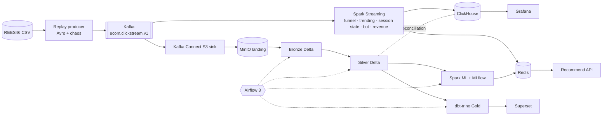

# E-commerce Big Data Platform — REES46 Lambda Lakehouse

Nền tảng dữ liệu cho sàn TMĐT xây trên **một nguồn duy nhất**: clickstream REES46
(*eCommerce behavior data from multi category store*, ~285M event, 10/2019–04/2020).
Hai luồng xử lý chạy song song trên cùng dữ liệu:

- **Hot path (speed)**: Kafka → Spark Structured Streaming → ClickHouse/Redis → Grafana, Recommend API (độ trễ giây).
- **Cold path (batch)**: Kafka Connect → MinIO landing → Delta Bronze/Silver (Spark) → Gold (dbt-trino) → Superset, ML (theo ngày).
- **Reconciliation** so sánh batch ↔ speed mỗi giờ để đo độ chính xác của speed layer.



## Quick start

```bash
make init                 # .env (+ Fernet key), build images  (~10–15 phút lần đầu)
make download && make sample   # REES46 từ Kaggle -> data/raw, tạo sample 1% -> data/sample
make up-core              # Kafka, Schema Registry, MinIO, Postgres, Redis, ClickHouse
make up-stream            # Kafka Connect + Spark + streaming jobs
make replay               # bắt đầu phát lại REES46 (REPLAY_SPEED trong .env)
make up-batch up-bi up-ml # Trino/HMS/Airflow, Grafana/Superset/Jupyter, MLflow/API
make smoke                # kiểm tra end-to-end
```

| UI | URL | Đăng nhập |
|---|---|---|
| Grafana (real-time) | http://localhost:3000 | admin / admin123 |
| Airflow | http://localhost:8091 | (SimpleAuthManager – all admins) |
| Superset (batch BI) | http://localhost:8088 | admin / admin123 |
| Spark master / driver | http://localhost:8080 · :4040 | – |
| Trino | http://localhost:8090 | user bất kỳ |
| MinIO console | http://localhost:9001 | minioadmin / minioadmin123 |
| Kafka UI (`--profile obs`) | http://localhost:8085 | – |
| MLflow | http://localhost:5000 | – |
| Recommend API (OpenAPI) | http://localhost:8000/docs | – |
| Jupyter | http://localhost:8888 | token `ecom` |

> Cần Docker ≥ 24 với Compose v2, **≥ 16 GB RAM** cho Docker khi chạy toàn bộ (core + stream ≈ 8 GB).

## Tài liệu

- **[docs/IMPLEMENTATION_GUIDE.md](docs/IMPLEMENTATION_GUIDE.md)** — hướng dẫn triển khai chi tiết từng flow, data contract, vận hành, roadmap nhóm.
- [docs/adr/](docs/adr/) — các quyết định kiến trúc (scope REES46, Delta path-based, định nghĩa order, Airflow 3 + dbt).

## Cấu trúc repo (rút gọn)

```
infra/          # Dockerfile + config cho từng hạ tầng (spark, airflow, trino, clickhouse, ...)
schemas/        # data contracts: Avro (Kafka), JSON schema (alerts)
libs/ecom_common/   # code dùng chung: config, spark session, table registry, transforms, features
services/       # long-running apps: clickstream-producer, recommend-api
pipelines/      # streaming/ · batch/ · quality/ · dbt/ · ml/
orchestration/airflow/  # DAGs + helpers
scripts/  tests/  notebooks/  docs/
```

## Phát triển

```bash
python3.11 -m venv .venv && . .venv/bin/activate
pip install -r requirements-dev.txt     # cần Java 17 cho test PySpark
make lint test
pre-commit install
```
